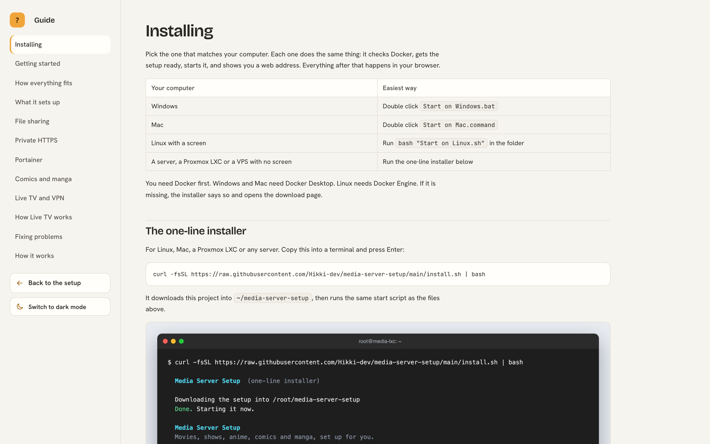

# Media Server Setup

One page in your browser that installs a complete home media server and connects every part of it.

You answer a few simple questions. The setup does the rest: it installs the apps, links them together, and tries a real search to prove it works before it says it is done.

## What you get

<table>
<tr><td width="64"></td><td width="150"><b>Jellyfin</b></td><td>Where you watch your movies, shows, anime and live TV</td></tr>
<tr><td></td><td><b>Seerr</b></td><td>A page where family and friends ask for something to watch</td></tr>
<tr><td></td><td><b>Sonarr</b></td><td>Finds and downloads TV shows and anime</td></tr>
<tr><td></td><td><b>Radarr</b></td><td>Finds and downloads movies</td></tr>
<tr><td></td><td><b>Prowlarr</b></td><td>Keeps the list of websites that Sonarr and Radarr search</td></tr>
<tr><td></td><td><b>qBittorrent</b></td><td>Does the downloading, and stops uploading when it is done</td></tr>
<tr><td></td><td><b>Bazarr</b></td><td>Finds subtitles, English first</td></tr>
<tr><td></td><td><b>FlareSolverr</b></td><td>Helps the searches get past robot checks on search websites</td></tr>
<tr><td></td><td><b>Homepage</b></td><td>One page with a button for every app</td></tr>
<tr><td></td><td><b>Tailscale</b> (optional)</td><td>A private way to reach everything from anywhere, with safe HTTPS addresses</td></tr>
</table>

It also sets up quality choices for each language you watch, size limits, notifications to your chat app, and optional live TV and sports channels.

## How everything fits together

Ask once in Seerr, and the rest happens by itself. The small numbers on the arrows are the standard ports of each app. Click the picture to see it full size.

## See it, one step at a time

Every screen explains itself in plain words. These are the main ones. Click a picture to see it full size. The full walk through is in [docs/Getting started.md](docs/Getting%20started.md).

### Where is everything kept

It shows which folders are on the same drive, so finished downloads are linked instantly instead of copied.

### Pick folders you already have

Browse your drives and choose a folder. Nothing inside it is moved, renamed or deleted.

### What you watch

One click chooses the quality rules, the search sites and the subtitle languages.

### Live TV and sports

Optional. Free channels with a TV guide, tested every day.

### Profiles

Each language gets its own picture quality and size limits.

### Downloads

Sensible defaults. A finished download is removed, so nothing keeps uploading.

### Apps and accounts

Choose what else to install, and the main login.

### File sharing

Optional. Shows your media and drives on your network, with one login.

### Private HTTPS addresses

Optional. Safe addresses for every app, with Tailscale.

### Review

One last look at everything before anything is installed.

## Before you start

1. A computer that can run Docker. Windows and Mac need Docker Desktop. Linux needs Docker Engine.
2. About 8 GB of memory and 20 GB of free space for the apps. Your media needs its own space.
3. An internet connection. The first install downloads several GB.

## Install

1. Download this project and unzip it, or use the green Code button on GitHub.
2. Start the file for your computer:
   * Windows: double click "Start on Windows.bat"
   * Mac: double click "Start on Mac.command". The first time, right click it and choose Open.
   * Linux: open a terminal in this folder and run: bash "Start on Linux.sh"
3. Your browser opens at http://localhost:7979. Answer the questions and press Install.

The first install takes 5 to 15 minutes. You can stop it at any time. Stopping never touches your media.

## Use it with Claude Code

Copy this folder into your Claude skills folder and name it media-server-setup. Then say "set up my media server". Claude starts the setup, stays with you, and checks that everything works. See SKILL.md for what Claude does.

## Already have some of these apps

You do not have to start again. The setup finds the apps already on your computer. For each one you choose to keep using yours or install a new one beside it. Any mix works.

Before anything is touched, the What changes page lists every setting the setup wants to change, next to how it is set today. Each part has a switch to keep yours. Nothing is changed until you say so. Connections you already have, logins, request rules, folder names and search sites you added are kept unless you switch them.

## Light and dark mode

The setup page and the guide start in a soft light theme that is easy on the eyes. A button at the bottom of the left side switches to dark mode, and the choice is remembered.

Light mode, the default.

Dark mode, one button away.

## A guide with pictures

The setup page has a guide at the bottom of the left side: Open the guide. It is the same set of pages as the docs folder, with screenshots and a picture of how the apps work together. Start with docs/Getting started.md.

## Private HTTPS addresses

This part is optional. With Tailscale on the server, every app gets a safe HTTPS address that works from any of your own devices, at home or away, and Homepage links are changed to match. Nothing is opened on your router. It can also be used on its own, for any Docker containers. See docs/Private HTTPS.md.

## Share your folders and drives

This part is optional. It makes your media folder and your other drives show up on your home network, so you can open them from Windows, Mac, Linux and phones, and reach them from anywhere with Tailscale. It uses one login, no guest access, and settings chosen for speed and safety. It works on Linux. You can switch it on in the setup page, or use the script in extras/File sharing on a computer that does not run the setup. The guide also explains how to prepare your drives properly. See docs/File sharing.md.

## Live TV and sports

This part is optional. It adds a Live TV section to Jellyfin from free public channel lists, tests every channel, and removes broken ones every day. You can pick countries, kinds of channel and languages. It can also add live news channels on YouTube. NordVPN can be added so channels that only work in some countries are tried through the UK and the US.

Paid sports are not on free lists, so they are not included. If you pay a TV provider, you can paste their channel list and guide links. See docs/Live TV and VPN.md.

## Your privacy and safety

1. Everything runs on your own computer. Nothing is sent to us, and there is no tracking.
2. Passwords you choose are kept in a private file on your computer. They are never shown in logs or sent anywhere except to your own apps.
3. Downloads are made safe. Program files (like .exe) are blocked, nothing is run when a download finishes, and quality choices turn down downloads that mention programs or cracks.
4. Your own apps are only read until you approve the changes.

To report a security problem, read SECURITY.md.

## Help and more reading

1. docs/What it sets up.md explains everything the setup does.
2. docs/Fixing problems.md covers the common problems.
3. docs/Live TV and VPN.md covers channels and NordVPN.
4. docs/File sharing.md covers sharing your folders and drives, setting up drives, and using them away from home.
5. docs/Private HTTPS.md covers safe addresses for every app with Tailscale.
   docs/Portainer.md covers keeping the apps in Portainer stacks, and the mistakes that leave apps stopped.
6. docs/Getting started.md and docs/How everything fits.md are the guide with pictures.
7. docs/How it works.md is for people who want to change the code.

## Contributing

Fixes and ideas are welcome. Read CONTRIBUTING.md first. It explains how to run the checks and what we ask of every change.

## Credits

The app logos in the pictures are from the Dashboard Icons collection and belong to their projects. The quality rules come from the TRaSH Guides. Channel lists come from the iptv org project, and TV guides from EPG Share. Thank you to everyone who keeps these free.

## Licence

MIT. You can use, change and share this freely. See LICENSE.
