# Media Server Setup

One page in your browser that installs a complete home media server, and connects every part of it for you.

<p align="center">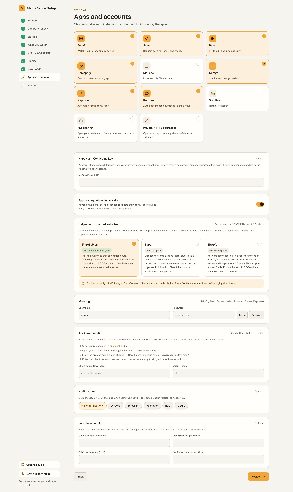</p>

You answer a few simple questions. The setup installs the apps, links them together, and then tries a real search to prove that everything works.

You do not need to know how any of the apps work. Everything is explained in plain words on the way.

**Jump to:** [What you get](#what-you-get), [How it fits together](#how-everything-fits-together), [Install](#install), [Screenshots](#see-it-one-step-at-a-time), [Optional extras](#optional-extras), [Help](#help-and-more-reading)

## What you get

Each app does one small job. Together they find, download, tidy and play your movies, shows and anime.

<table>
<tr><td width="64"></td><td width="170"><b>Jellyfin</b></td><td>Where you watch your movies, shows, anime and live TV</td></tr>
<tr><td>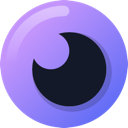</td><td><b>Seerr</b></td><td>A page where family and friends ask for something to watch</td></tr>
<tr><td></td><td><b>Sonarr</b></td><td>Finds and downloads TV shows and anime</td></tr>
<tr><td></td><td><b>Radarr</b></td><td>Finds and downloads movies</td></tr>
<tr><td></td><td><b>Prowlarr</b></td><td>Keeps the list of websites that Sonarr and Radarr search</td></tr>
<tr><td></td><td><b>qBittorrent</b></td><td>Does the downloading, and stops uploading when it is done</td></tr>
<tr><td></td><td><b>Bazarr</b></td><td>Finds subtitles, English first</td></tr>
<tr><td></td><td><b>FlareSolverr</b></td><td>Helps the searches get past robot checks on search websites</td></tr>
<tr><td></td><td><b>Kapowarr</b> (optional)</td><td>Finds and downloads comics (not manga), using <a href="https://github.com/Hikki-dev/Kapowarr">my own copy</a> with fixes</td></tr>
<tr><td></td><td><b>Kaizoku</b> (optional)</td><td>Follows manga and downloads new chapters</td></tr>
<tr><td></td><td><b>Homepage</b></td><td>One page with a button for every app</td></tr>
<tr><td></td><td><b>Tailscale</b> (optional)</td><td>A private way to reach everything from anywhere, with safe HTTPS addresses</td></tr>
</table>

The setup also chooses quality rules for each language you watch, sets size limits, and can send a message to your chat app when something downloads.

To see exactly what is set up and why, read [What it sets up](docs/What%20it%20sets%20up.md).

## How everything fits together

Ask once in Seerr, and the rest happens by itself.

Seerr passes your request to Radarr or Sonarr. They search through Prowlarr, and qBittorrent downloads the best match into your library. Bazarr adds subtitles, and Jellyfin plays it on any device.

The small numbers on the arrows are the standard ports of each app. Click the picture to see it full size.

<p align="center"><a href="docs/images/how-it-fits.svg"></a></p>

The full story of one request, step by step, is in [How everything fits](docs/How%20everything%20fits.md).

## Before you start

You need three things:

1. A computer that can run Docker. Windows and Mac need Docker Desktop. Linux needs Docker Engine.
2. About 8 GB of memory and 20 GB of free space for the apps. Your media needs its own space on top of that.
3. An internet connection. The first install downloads several GB.

## Install

Pick the way that fits you. They all do the same thing.

| Your computer | Do this |
|---|---|
| Windows | Download this project, unzip it, double click `Start on Windows.bat` |
| Mac | Download this project, unzip it, double click `Start on Mac.command`. The first time, right click it and choose Open |
| Linux with a screen | Download this project, unzip it, run `bash "Start on Linux.sh"` |
| A server, a Proxmox LXC or a VPS | Run the one line below. No download, no screen needed |

```bash
curl -fsSL https://raw.githubusercontent.com/Hikki-dev/media-server-setup/main/install.sh | bash
```

The window shows each step with a spinner and a tick, then a web address. Your browser opens at `http://localhost:7979` by itself, or you open the address on another computer when the machine has no screen. Answer the questions and press **Install everything**.

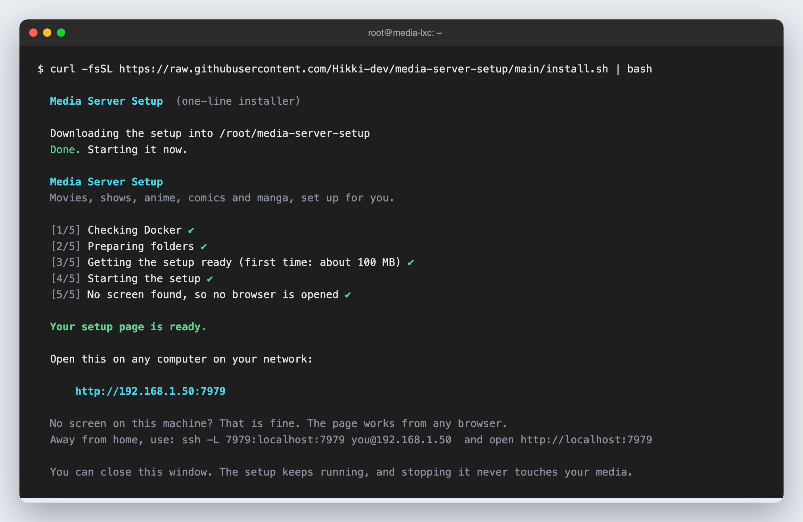

Pictures of every start window, and help for a server with no screen, are in [Installing](docs/Installing.md).

The first install takes 5 to 15 minutes. You can stop it at any time, and stopping never touches your media.

When it finishes, the last page lists a link and a login for every app. If something does not work, start with [Fixing problems](docs/Fixing%20problems.md).

## See it, one step at a time

Every screen explains itself in plain words. These are the main ones. Click a picture to see it full size.

The full walk through, with every screen, is in [Getting started](docs/Getting%20started.md). The same pages are inside the setup page too: press **Open the guide** at the bottom of the left side.

### Where is everything kept

<a href="docs/images/step-4-storage.png">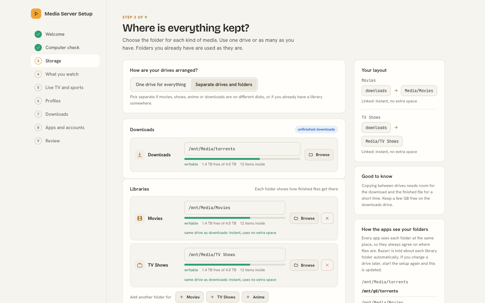</a>

Choose one folder for downloads and one for each kind of media.

The panel on the right shows which folders are on the same drive. When they are, a finished download is linked into your library instantly, with no extra space used.

### Pick folders you already have

<a href="docs/images/step-4-folder-picker.png">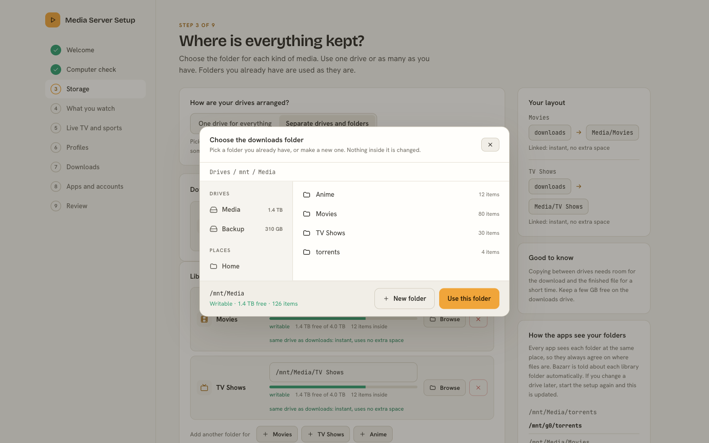</a>

Press Browse to open your drives and choose a folder. You can make a new folder there too.

Nothing inside a folder you already have is moved, renamed or deleted.

### What you watch

<a href="docs/images/step-5-what-you-watch.png">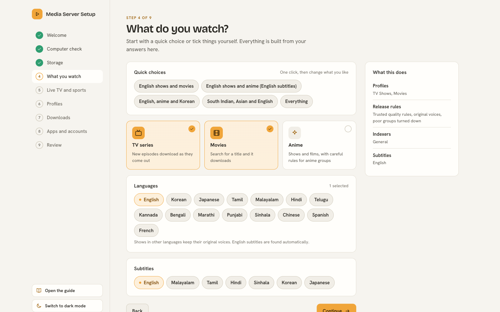</a>

Press a quick choice, or tick things yourself.

Each choice sets the quality rules, the search websites and the subtitle languages for you.

### Live TV and sports

<a href="docs/images/step-6-live-tv.png"></a>

This step is optional. Pick the countries and kinds of channel you want.

The setup builds a channel list with a TV guide and tests it every day. Read more in [How Live TV works](docs/How%20Live%20TV%20works.md) and [Live TV and VPN](docs/Live%20TV%20and%20VPN.md).

### Profiles

<a href="docs/images/step-7-profiles.png">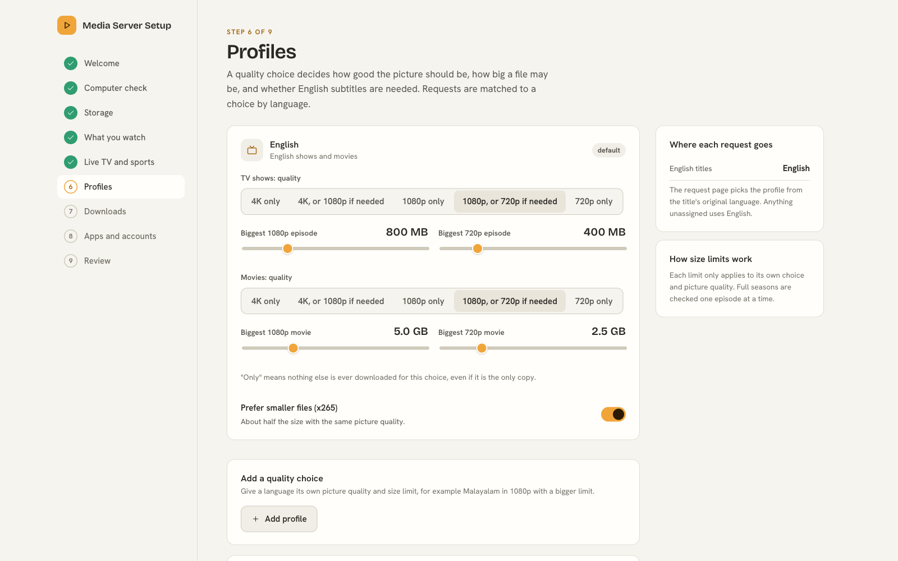</a>

A profile is a set of quality and size limits.

Each language you watch can have its own, for example a bigger size limit for films in a language with fewer releases.

### Downloads

<a href="docs/images/step-8-downloads.png">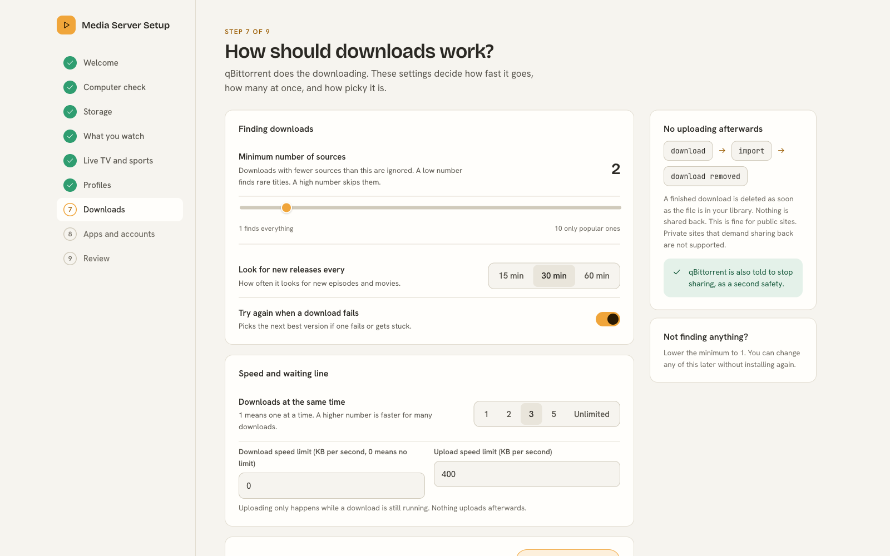</a>

The defaults suit most people.

A finished download is always removed from the downloader, so nothing keeps uploading in the background.

### Apps and accounts

<a href="docs/images/step-9-apps.png"></a>

Choose what else to install, and the main login that Jellyfin, Seerr, Sonarr, Radarr and Prowlarr share.

The optional extras, file sharing and private HTTPS addresses, are tiles here too.

### File sharing

<a href="docs/images/step-9-file-sharing.png">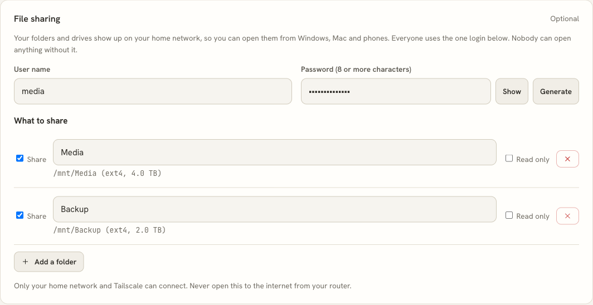</a>

This step is optional. It shows your media and drives on your home network.

Each folder has a tick box and a read only choice. Read more in [File sharing](docs/File%20sharing.md).

### Private HTTPS addresses

<a href="docs/images/step-9-private-https.png">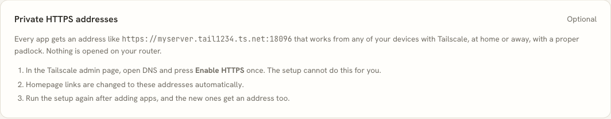</a>

This step is optional. Every app gets a safe address that works from your own devices anywhere.

Read more in [Private HTTPS](docs/Private%20HTTPS.md).

### Review

<a href="docs/images/step-10-review.png">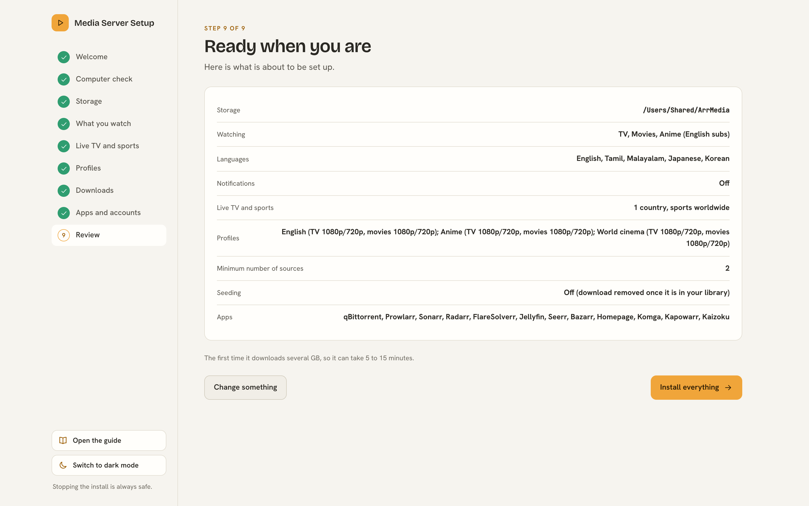</a>

One last look at everything before anything is installed.

Press Install everything when you are happy. You can stop at any time.

## Optional extras

None of these are needed. Turn on only what you want, in the setup page.

### Live TV and sports

Adds a Live TV section to Jellyfin from free public channel lists. Every channel is tested, and broken ones are removed each day.

You choose the countries, the kinds of channel and the languages. It can also add live news channels from YouTube.

NordVPN can be added, so channels that only work in some countries are tried through the UK and the US. Paid sports are not on free lists, so they are not included.

The list is rebuilt every night, so broken channels disappear and new ones appear by themselves.

<a href="docs/images/livetv-daily.svg">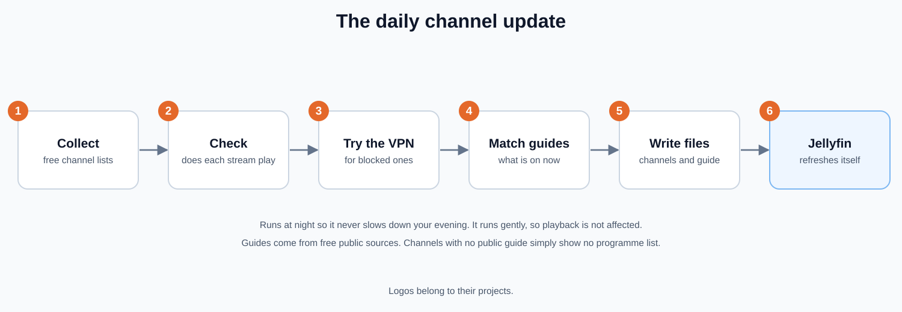</a>

Blocked channels reach Jellyfin through the VPN. Everything else plays directly.

<a href="docs/images/livetv-routing.svg"></a>

Read more: [How Live TV works](docs/How%20Live%20TV%20works.md) and [Live TV and VPN](docs/Live%20TV%20and%20VPN.md).

### File sharing

Shows your media folder and your other drives on your home network. You can open them from Windows, Mac, Linux and phones.

It uses one login, no guest access, and settings chosen for speed and safety. It works on Linux.

Read more: [File sharing](docs/File%20sharing.md). It also explains [how to set up your drives properly](docs/File%20sharing.md#set-up-your-drives-properly) and [how to use them away from home](docs/File%20sharing.md#use-it-away-from-home).

If your computer does not run the setup page, use the script in the `extras/File sharing` folder instead. Its [read me](extras/File%20sharing/Read%20me.md) explains how.

### Private HTTPS addresses

With Tailscale on your server, every app gets a safe address that works from any of your own devices, at home or away. Homepage links are changed to match.

Nothing is opened on your router.

Read more: [Private HTTPS](docs/Private%20HTTPS.md). The tool also works on its own for any Docker containers, see [how to keep your own list of ports](docs/Private%20HTTPS.md#keep-your-own-list).

### Portainer

If you manage Docker with Portainer, keep the apps in stacks. The guide explains what an update really does, and the mistakes that leave apps stopped.

Read more: [Portainer](docs/Portainer.md).

### Light and dark mode

The setup page and the guide start in a soft light theme that is easy on the eyes. A button at the bottom of the left side switches to dark mode, and your choice is remembered.

<a href="docs/images/step-1-welcome.png">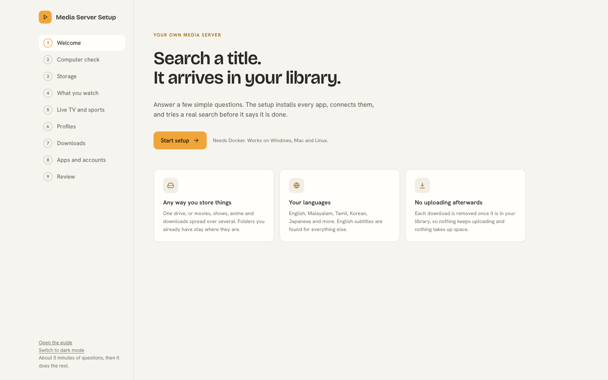</a>

Light mode, the default.

<a href="docs/images/dark-mode-apps.png">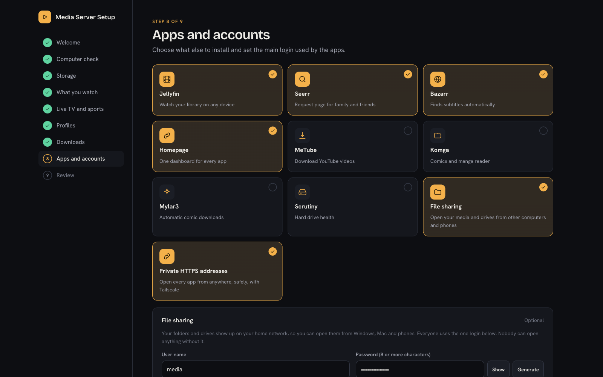</a>

Dark mode, one button away.

### Use it with Claude Code

Copy this folder into your Claude skills folder and name it `media-server-setup`. Then say "set up my media server".

Claude starts the setup, stays with you, and checks that everything works. [SKILL.md](SKILL.md) explains what Claude does.

### Already have some of these apps

You do not have to start again. The setup finds the apps already on your computer, and for each one you choose to keep yours or install a new one beside it.

Before anything is touched, a page called What changes lists every setting the setup wants to change, next to how it is set today. Each part has a switch to keep yours.

Nothing is changed until you say so. Your connections, logins, request rules, folder names and search sites are kept unless you switch them.

## Your privacy and safety

* Everything runs on your own computer. Nothing is sent to us, and there is no tracking.
* The passwords you choose are kept in a private file on your computer. They are never shown in logs, and never sent anywhere except to your own apps.
* Downloads are made safe. Program files such as `.exe` are blocked, nothing is run when a download finishes, and quality choices turn down downloads that mention programs or cracks.
* Your own apps are only read until you approve the changes.

To report a security problem, read [SECURITY.md](SECURITY.md).

## Help and more reading

| If you want to | Read |
|---|---|
| Install it on Windows, Mac, Linux or a server | [Installing](docs/Installing.md) |
| Follow every screen with pictures | [Getting started](docs/Getting%20started.md) |
| Understand how the apps work together | [How everything fits](docs/How%20everything%20fits.md) |
| Know exactly what the setup does | [What it sets up](docs/What%20it%20sets%20up.md) |
| Fix a problem | [Fixing problems](docs/Fixing%20problems.md) |
| Add live TV and sports | [Live TV and VPN](docs/Live%20TV%20and%20VPN.md) |
| Add comics and manga | [Comics and manga](docs/Comics%20and%20manga.md) |
| Share your folders and drives | [File sharing](docs/File%20sharing.md) |
| Reach everything safely from anywhere | [Private HTTPS](docs/Private%20HTTPS.md) |
| Keep the apps in Portainer | [Portainer](docs/Portainer.md) |
| Change the code | [How it works](docs/How%20it%20works.md) and [Contributing](CONTRIBUTING.md) |
| See what changed in each version | [Changes](CHANGELOG.md) |

## Contributing

Fixes and ideas are welcome. Read [CONTRIBUTING.md](CONTRIBUTING.md) first.

It explains how to run the checks, and what we ask of every change.

## Credits

The app logos in the pictures are from the Dashboard Icons collection, and they belong to their projects.

The quality rules come from the TRaSH Guides. Channel lists come from the iptv org project, and TV guides from EPG Share. Thank you to everyone who keeps these free.

## Licence

MIT. You can use, change and share this freely. See [LICENSE](LICENSE).
