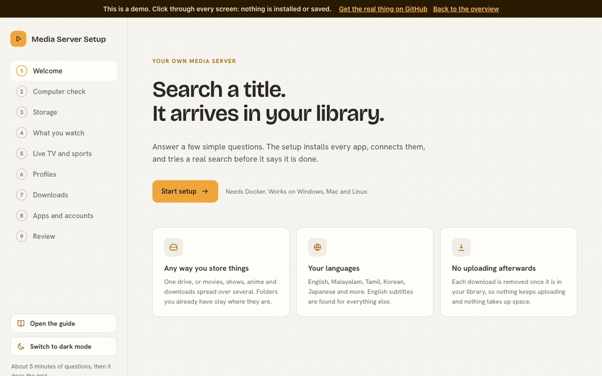
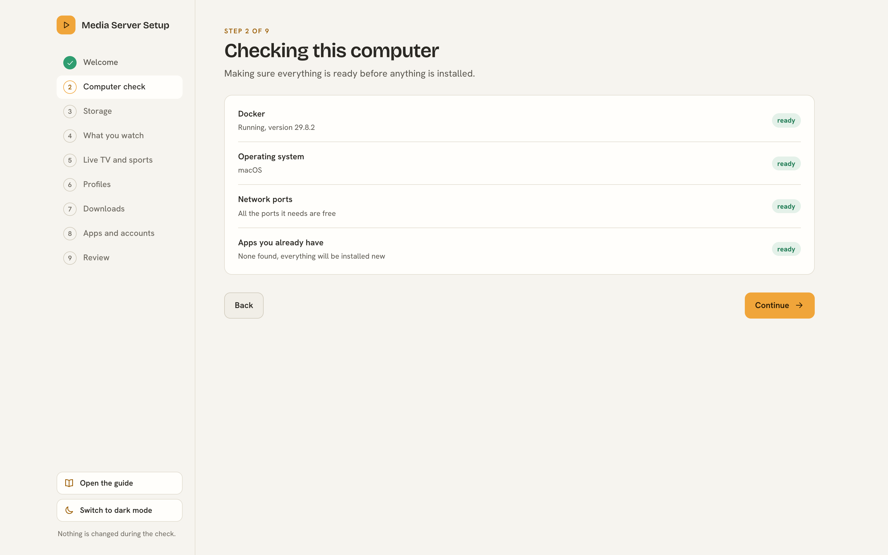

# Media Server Setup

[](https://github.com/Hikki-dev/media-server-setup/actions/workflows/checks.yml)
[](LICENSE)
[](https://media-server-setup.makkoacknowledgesstress.workers.dev/demo/)
[](https://media-server-setup.makkoacknowledgesstress.workers.dev)

One page in your browser that installs a complete home media server, and connects every part of it for you.

<p align="center"></p>

<p align="center"><sub>A short highlight of the setup page. <b><a href="https://media-server-setup.makkoacknowledgesstress.workers.dev/#tour">Watch the full 90 second tour</a></b>, or <a href="https://media-server-setup.makkoacknowledgesstress.workers.dev/demo/">try it yourself</a>. Nothing is installed.</sub></p>

You answer a few simple questions. The setup installs the apps, links them together, and then tries a real search to prove that everything works.

You do not need to know how any of the apps work. Everything is explained in plain words on the way.

## On this page

* [What you get](#what-you-get): the apps, and what each one does
* [How everything fits together](#how-everything-fits-together): one request, from asking to watching
* [Try it first](#try-it-first): the website and a demo that installs nothing
* [Before you start](#before-you-start): what your computer needs
* [Install](#install): Windows, Mac, Linux or a server (also [other hardware](docs/Other%20hardware.md))
* [The setup, step by step](#the-setup-step-by-step)
  * [1. Welcome](#1-welcome)
  * [2. Computer check](#2-computer-check)
  * [3. Where is everything kept](#3-where-is-everything-kept)
  * [4. What you watch](#4-what-you-watch)
  * [5. Live TV and sports](#5-live-tv-and-sports)
  * [6. Profiles](#6-profiles)
  * [7. Downloads](#7-downloads)
  * [8. Apps and accounts](#8-apps-and-accounts) (comics, manga, file sharing, private HTTPS)
  * [9. Review and install](#9-review-and-install)
* [After the install](#after-the-install): light and dark mode, Portainer, Claude Code
* [Your privacy and safety](#your-privacy-and-safety)
* [Help and more reading](#help-and-more-reading)
* [Legal and responsibility](#legal-and-responsibility)

## What you get

Each app does one small job. Together they find, download, tidy and play your movies, shows and anime.

<table>
<tr><td width="64"></td><td width="170"><b>Jellyfin</b></td><td>Where you watch your movies, shows, anime and live TV</td></tr>
<tr><td></td><td><b>Seerr</b></td><td>A page where family and friends ask for something to watch</td></tr>
<tr><td></td><td><b>Sonarr</b></td><td>Finds and downloads TV shows and anime</td></tr>
<tr><td></td><td><b>Radarr</b></td><td>Finds and downloads movies</td></tr>
<tr><td></td><td><b>Prowlarr</b></td><td>Keeps the list of websites that Sonarr and Radarr search</td></tr>
<tr><td></td><td><b>qBittorrent</b></td><td>Does the downloading, and stops uploading when it is done</td></tr>
<tr><td></td><td><b>Bazarr</b></td><td>Finds subtitles, English first</td></tr>
<tr><td></td><td><b>FlareSolverr</b></td><td>Helps the searches get past robot checks on search websites</td></tr>
<tr><td></td><td><b>Kapowarr</b> (optional)</td><td>Finds and downloads comics (not manga), using a personal build of <a href="https://github.com/Casvt/Kapowarr">Kapowarr</a> with fixes</td></tr>
<tr><td></td><td><b>Kaizoku</b> (optional)</td><td>Follows manga and downloads new chapters</td></tr>
<tr><td></td><td><b>Homepage</b></td><td>One page with a button for every app</td></tr>
<tr><td></td><td><b>Tailscale</b> (optional)</td><td>A private way to reach everything from anywhere, with safe HTTPS addresses</td></tr>
</table>

The setup also chooses quality rules for each language you watch, sets size limits, and can send a message to your chat app when something downloads.

To see exactly what is set up and why, read [What it sets up](docs/What%20it%20sets%20up.md).

## How everything fits together

Ask once in Seerr, and the rest happens by itself.

Seerr passes your request to Radarr or Sonarr. They search through Prowlarr, and qBittorrent downloads the best match into your library. Bazarr adds subtitles, and Jellyfin plays it on any device.

The small numbers on the arrows are the standard ports of each app. Click the picture to see it full size.

<p align="center"><a href="docs/images/how-it-fits.svg"></a></p>

The full story of one request, step by step, is in [How everything fits](docs/How%20everything%20fits.md).

## Try it first

**[Open the website](https://media-server-setup.makkoacknowledgesstress.workers.dev)** for the install command, or **[try the demo](https://media-server-setup.makkoacknowledgesstress.workers.dev/demo/)** to click through the whole setup page and read the guide without installing anything. It works on phones too. How to host it for free on Cloudflare is in [Demo website](docs/Demo%20website.md).

## Before you start

You need three things:

1. A computer that can run Docker. Windows and Mac need Docker Desktop. Linux needs Docker Engine.
2. About 8 GB of memory and 20 GB of free space for the apps. Your media needs its own space on top of that.
3. An internet connection. The first install downloads several GB.

## Install

Pick the way that fits you. They all do the same thing.

| Your computer | Do this |
|---|---|
| Windows | Download this project, unzip it, double click `Start on Windows.bat` |
| Mac | Download this project, unzip it, double click `Start on Mac.command`. The first time, right click it and choose Open |
| Linux with a screen | Download this project, unzip it, run `bash "Start on Linux.sh"` |
| A server, a Proxmox LXC or a VPS | Run the one line below. No download, no screen needed |

```bash
curl -fsSL https://raw.githubusercontent.com/Hikki-dev/media-server-setup/main/install.sh | bash
```

The window shows each step with a spinner and a tick, then a web address. Your browser opens at `http://localhost:7979` by itself, or you open the address on another computer when the machine has no screen. Answer the questions and press **Install everything**.


Pictures of every start window, and help for a server with no screen, are in [Installing](docs/Installing.md). A Proxmox LXC, a Raspberry Pi, a Synology and Unraid are covered in [Other hardware](docs/Other%20hardware.md).

The first install takes 5 to 15 minutes. You can stop it at any time, and stopping never touches your media. What each screen asks is explained in [the setup, step by step](#the-setup-step-by-step).

## The setup, step by step

Every screen explains itself in plain words, so you can go at your own pace. Click a picture to see it full size. The same pages are inside the setup page too: press **Open the guide** at the bottom of the left side. The full walk through is in [Getting started](docs/Getting%20started.md).

### 1. Welcome

<a href="docs/images/step-1-welcome.png"></a>

Press **Start setup**. Nothing is installed until the very last screen.

### 2. Computer check

<a href="docs/images/step-2-computer-check.png"></a>

The setup checks Docker, your system, the ports it needs, and whether you already run some of the apps.

**If it finds apps you already run:** you do not have to start again. For each one you choose to keep yours or install a new one beside it. Before anything is touched, a page called What changes lists every setting the setup wants to change, next to how it is set today, with a switch to keep yours. Nothing is changed until you say so.

### 3. Where is everything kept

<a href="docs/images/step-4-storage.png"></a>

Choose one folder for downloads and one for each kind of media. The panel on the right shows which folders are on the same drive. When they are, a finished download is linked into your library instantly, with no extra space used.

Press **Browse** to pick a folder. The list always starts with **This computer**, the internal drive, so you can keep everything on it. Other drives you plug in are listed after it.

<a href="docs/images/step-4-folder-picker.png"></a>

Nothing inside a folder you already have is moved, renamed or deleted.

### 4. What you watch

<a href="docs/images/step-5-what-you-watch.png"></a>

Press a quick choice, or tick things yourself. Each choice sets the quality rules, the search websites and the subtitle languages for you.

### 5. Live TV and sports

<a href="docs/images/step-6-live-tv.png"></a>

Optional. It adds a Live TV section to Jellyfin from free public channel lists.

* You choose the countries, the kinds of channel and the languages. It can also add live news channels from YouTube.
* Every channel is tested, and broken ones are removed. The list is rebuilt every night, so new ones appear by themselves.
* NordVPN can be added, so channels that only work in some countries are tried through the UK and the US.
* Paid sports are not on free lists, so they are not included.

<a href="docs/images/livetv-daily.svg"></a>

<a href="docs/images/livetv-routing.svg"></a>

Read more: [How Live TV works](docs/How%20Live%20TV%20works.md) and [Live TV and VPN](docs/Live%20TV%20and%20VPN.md).

### 6. Profiles

<a href="docs/images/step-7-profiles.png"></a>

A profile is a set of quality and size limits. Each language you watch can have its own, for example a bigger size limit for films in a language with fewer releases.

### 7. Downloads

<a href="docs/images/step-8-downloads.png"></a>

The defaults suit most people. A finished download is always removed from the downloader, so nothing keeps uploading in the background.

### 8. Apps and accounts

<a href="docs/images/step-9-apps.png"></a>

Choose what else to install, and the main login that Jellyfin, Seerr, Sonarr, Radarr, Prowlarr, Bazarr and Kapowarr share. Everything below is optional.

* **Komga** reads your comics and manga.
* **Kapowarr** finds and downloads comics. Paste a free ComicVine key in the card that appears. See [Comics and manga](docs/Comics%20and%20manga.md).
* **Kaizoku** follows manga and downloads new chapters.
* **File sharing** shows your media and drives on your home network, so you can open them from Windows, Mac, Linux and phones. One login, no guest access, Linux only. See [File sharing](docs/File%20sharing.md), which also explains [how to set up your drives](docs/File%20sharing.md#set-up-your-drives-properly). Without the setup page, use the script in `extras/File sharing`; its [read me](extras/File%20sharing/Read%20me.md) explains how.
* **Private HTTPS addresses** give every app a safe address that works from your own devices anywhere, with Tailscale. Nothing is opened on your router. See [Private HTTPS](docs/Private%20HTTPS.md).

<a href="docs/images/step-9-file-sharing.png"></a>

<a href="docs/images/step-9-private-https.png"></a>

### 9. Review and install

<a href="docs/images/step-10-review.png"></a>

One last look at everything before anything is installed. Press **Install everything** when you are happy. You can stop at any time.

When it finishes, the last page lists a link and a login for every app. If something does not work, start with [Fixing problems](docs/Fixing%20problems.md).

## After the install

### Light and dark mode

The setup page and the guide start in a soft light theme. A button at the bottom of the left side switches to dark mode, and your choice is remembered.

<a href="docs/images/dark-mode-apps.png"></a>

### Keep the apps in Portainer

If you manage Docker with Portainer, keep the apps in stacks. The guide explains what an update really does, and the mistakes that leave apps stopped. See [Portainer](docs/Portainer.md).

### Use it with Claude Code

Copy this folder into your Claude skills folder and name it `media-server-setup`. Then say "set up my media server". Claude starts the setup, stays with you, and checks that everything works. [SKILL.md](SKILL.md) explains what Claude does.

## Your privacy and safety

* Everything runs on your own computer. Nothing is sent to us, and there is no tracking.
* The passwords you choose are kept in a private file on your computer. They are never shown in logs, and never sent anywhere except to your own apps.
* Downloads are made safe. Program files such as `.exe` are blocked, nothing is run when a download finishes, and quality choices turn down downloads that mention programs or cracks.
* Your own apps are only read until you approve the changes.

To report a security problem, read [SECURITY.md](SECURITY.md).

## Help and more reading

| If you want to | Read |
|---|---|
| Install it on Windows, Mac, Linux or a server | [Installing](docs/Installing.md) |
| Use a Proxmox LXC, Raspberry Pi, Synology or Unraid | [Other hardware](docs/Other%20hardware.md) |
| Tune a home server | [Best settings](docs/Best%20settings.md) |
| Find a quick answer | [Questions and answers](docs/FAQ.md) |
| Follow every screen with pictures | [Getting started](docs/Getting%20started.md) |
| Understand how the apps work together | [How everything fits](docs/How%20everything%20fits.md) |
| Know exactly what the setup does | [What it sets up](docs/What%20it%20sets%20up.md) |
| Fix a problem | [Fixing problems](docs/Fixing%20problems.md) |
| Add live TV and sports | [Live TV and VPN](docs/Live%20TV%20and%20VPN.md) |
| Add comics and manga | [Comics and manga](docs/Comics%20and%20manga.md) |
| Share your folders and drives | [File sharing](docs/File%20sharing.md) |
| Reach everything safely from anywhere | [Private HTTPS](docs/Private%20HTTPS.md) |
| Keep the apps in Portainer | [Portainer](docs/Portainer.md) |
| Change the code | [How it works](docs/How%20it%20works.md) and [Contributing](CONTRIBUTING.md) |
| See what changed in each version | [Changes](CHANGELOG.md) |

## Legal and responsibility

* This project hosts no media. It is a setup tool: it installs and connects other free programs on your own computer.
* Use it only for content you have the right to, such as your own files, public domain and openly licensed works, and anything the law and the owner allow where you live.
* You are responsible for what you download, share and watch. Check the rules where you live.
* The apps it installs are separate projects with their own licences. The people who make this project do not encourage breaking the law, and are not responsible for how it is used.
* It is provided as it is, under the MIT licence, with no promises.

## Contributing

Fixes and ideas are welcome. Read [CONTRIBUTING.md](CONTRIBUTING.md) first.

It explains how to run the checks, and what we ask of every change.

## Credits

The app logos in the pictures are from the Dashboard Icons collection, and they belong to their projects.

The quality rules come from the TRaSH Guides. Channel lists come from the iptv org project, and TV guides from EPG Share. Thank you to everyone who keeps these free.

## Licence

MIT. You can use, change and share this freely. See [LICENSE](LICENSE).
