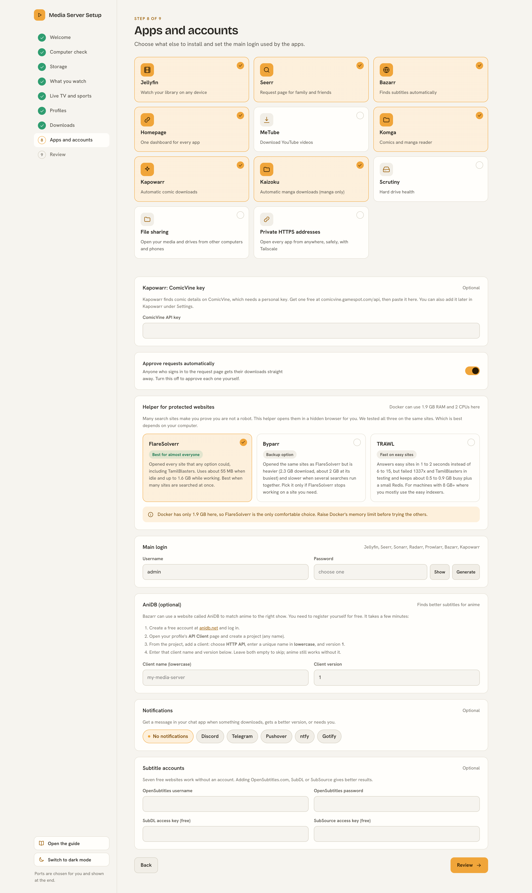
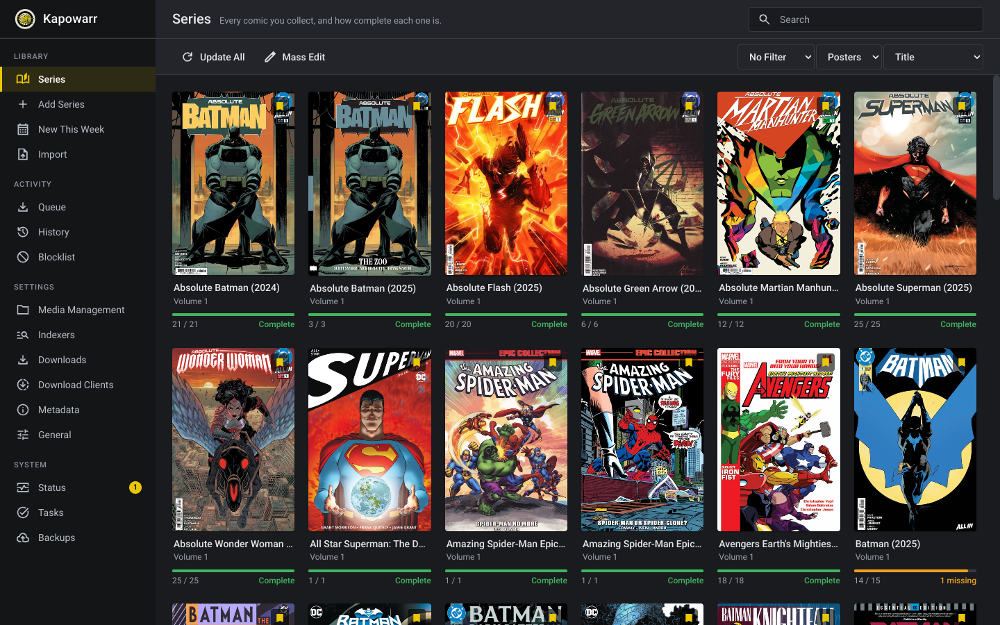
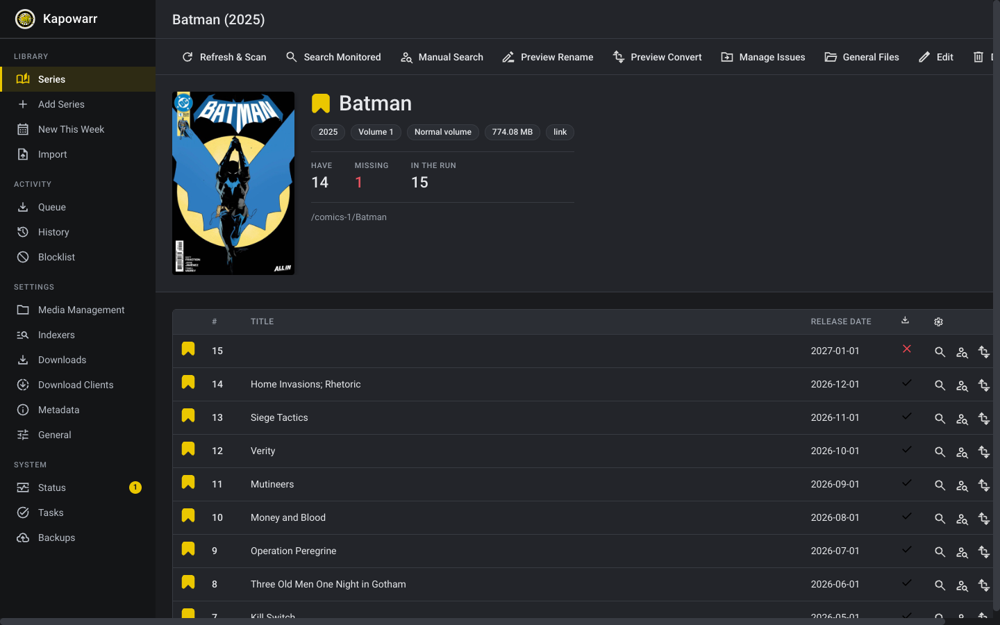
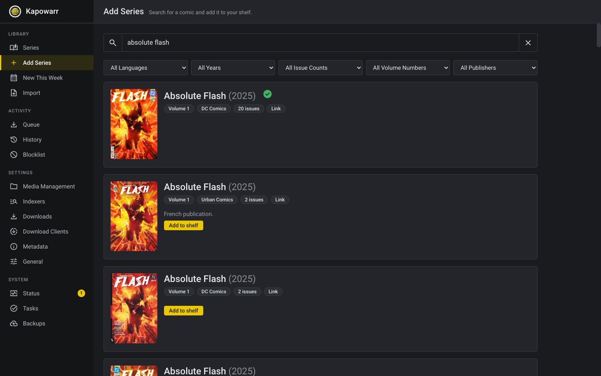
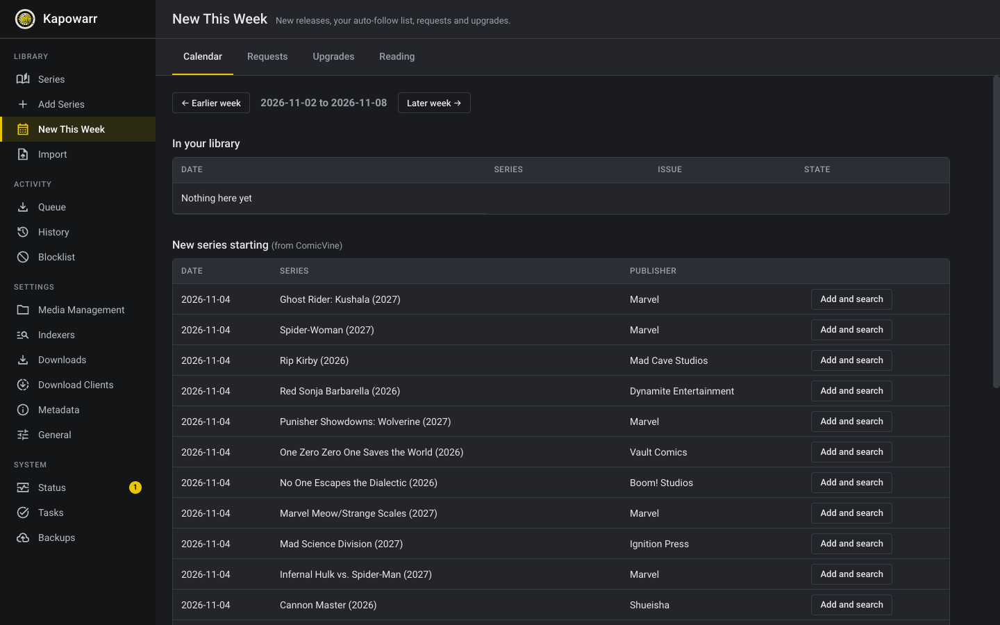
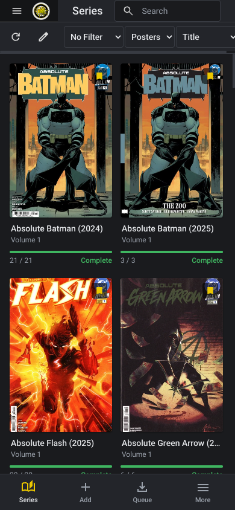

# Comics and manga

This is optional. Switch on **Kapowarr** for comics and **Kaizoku** for manga on the Apps step. Each one has its own job, and both save into folders that Komga (the reader) can open.

## What each app does

| App | What it does for you | Where you open it |
|---|---|---|
| Kapowarr | Finds and downloads **comics** and keeps them tidy. It does not do manga | Port 5656 |
| Kaizoku | Follows **manga** series and downloads new chapters by itself | Port 9833 |
| FlareSolverr | Helps Kapowarr open comic websites that check for robots | Never, it works quietly |
| Komga | The reader. Open it on any device to read what was downloaded | Port 25600 |

## Kapowarr

The setup uses my fork of Kapowarr, [Hikki-dev/Kapowarr](https://github.com/Hikki-dev/Kapowarr), in place of Mylar. It is a real GitHub fork of the original: it follows the original's newest work (merged every week), nothing is ever pushed back to the original, and every change is listed in its [FORK-NOTES.md](https://github.com/Hikki-dev/Kapowarr/blob/main/FORK-NOTES.md). The image is `ghcr.io/hikki-dev/kapowarr-fork`, which is public. It adds:

1. **Prowlarr as a source.** One search asks all your torrent sites at once, comics first, so an answer comes in about ten seconds. Torrent links of every kind become magnet links for qBittorrent.
2. **The Internet Archive as a source**, for public domain and archived comics, downloaded directly.
3. A database from an older copy is upgraded by itself, and your Prowlarr settings become a Prowlarr source.

Kapowarr's **New This Week** page (in its menu) has a release calendar that can follow new series by itself, a request list, quality upgrades and your Komga reading progress. See the fork's [Extras guide](https://github.com/Hikki-dev/Kapowarr/blob/main/docs/Extras.md).

Torrent results are ranked with seeders in mind (a torrent nobody shares goes last), searches are remembered for ten minutes, and a finished torrent is hard linked into the comics folder, so it takes no second copy. Optional messages (ntfy, Discord) and a Komga scan after each import are switched on with environment variables; see the fork's [Notifications, Komga and metrics](https://github.com/Hikki-dev/Kapowarr/blob/main/docs/Notifications%20Komga%20and%20metrics.md).

Comics from GetComics are downloaded straight into your comics folder. Comics from torrents are downloaded by qBittorrent and then copied into the same folder, so there are always two ways to get an issue.

When the install finishes, the setup has already done this inside Kapowarr:

1. FlareSolverr is linked, so comic websites open.
2. Prowlarr is linked, so torrent search works too.
3. qBittorrent is added as a download client.
4. `/comics` is added as the root folder.
5. The admin login is the same as the other apps.

You do one thing yourself: paste a **ComicVine key**. It is free at comicvine.gamespot.com/api. Paste it on the Apps step, or later in Kapowarr under Settings. Without it Kapowarr cannot look up comics.

Then open **Add Series**, search for a comic, and choose **Add to shelf**. Pick the root folder, and Kapowarr starts looking for its issues. You can also open the series and press **Search Monitored**.

### What Kapowarr looks like

Kapowarr has the familiar Sonarr and Radarr layout, made easier to read. Your shelf shows how complete every comic is.

A series page opens with how many issues you have, how many are missing, and the issue list.

Adding a comic is a search box. Results come from ComicVine.

**New This Week** shows what is coming out and can add new series for you.

On a phone, the menu is a bar at the bottom.

The screenshots come from the fork's [interface guide](https://github.com/Hikki-dev/Kapowarr/blob/main/docs/Interface.md), which also shows the light theme.

## Kaizoku

The setup uses [my fork of Rensaiō](https://github.com/Hikki-dev/Rensaio), which carries on the archived Kaizoku. Like the Kapowarr fork, it follows the original every week and lists every change in its [FORK-NOTES.md](https://github.com/Hikki-dev/Rensaio/blob/main/FORK-NOTES.md). It follows manga series and downloads each new chapter, using the same sources as the Mihon app. It is one container and needs no database.

Most manga are on several sites, and sites break. My copy handles that:

* It reads your manga folder when you add a series, so chapters you already have are never fetched again.
* One chapter comes from one site, not from every site.
* If a site fails on a chapter, the next working site takes it.
* A site that is down is skipped instead of being asked tens of thousands of times.

1. Open Kaizoku on port 9833 and add a manga source the first time.
2. Search for a manga and add it. Chapters download into `books/manga`.
3. Komga picks them up on its next scan.

Already have part of a series on disk? Add it from the command line and let it choose the best site and the right place to continue: `extras/Kaizoku smart add`.

## Where the files go

Both apps write inside the media folder you chose, in the `books` folder:

| Folder | Used by |
|---|---|
| `books/comics` | Kapowarr |
| `books/manga` | Kaizoku |

In Komga, add the library `books` (or each folder on its own) once.

## Moving from Mylar

Mylar is gone. If you switched it on before, running the setup again turns on Kapowarr in its place and leaves your old `config/mylar3` folder alone. Your comic files stay where they are.

## If something does not work

| What you see | Reason | What to do |
|---|---|---|
| Kapowarr cannot find any comic | No ComicVine key | Paste the key in Kapowarr, Settings |
| The setup says it used the original Kapowarr | The fork's image (`ghcr.io/hikki-dev/kapowarr-fork`) could not be downloaded, for example with no internet to ghcr.io | Nothing breaks. Comics work the same, without the fork's extra fixes. Run the setup again once ghcr.io is reachable |
| A comic site does not open | FlareSolverr is not running | Restart FlareSolverr, then try again |
| Kaizoku shows an error on first start | Its database was still starting | Wait a minute and refresh |
| The setup says it used the original Rensaiō | The fork's image (`ghcr.io/hikki-dev/rensaio`) could not be downloaded | Nothing breaks. Manga work the same, without the fork's fixes. Run the setup again once ghcr.io is reachable |
| Komga shows nothing | It has not scanned yet | Press Scan library in Komga |
