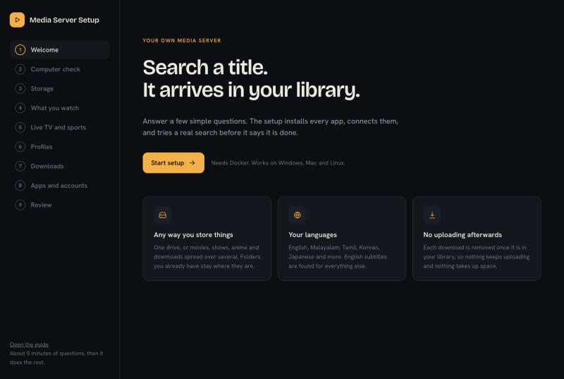
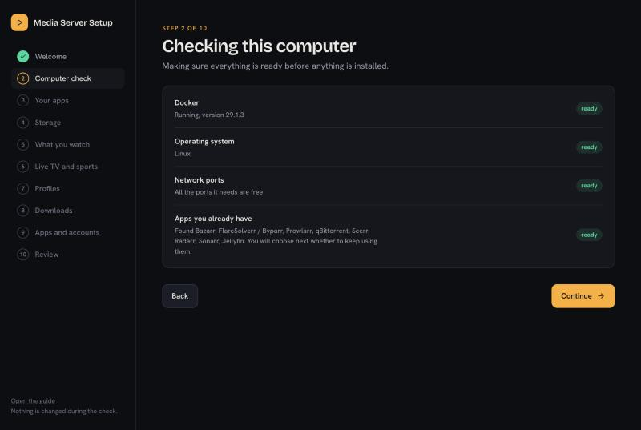
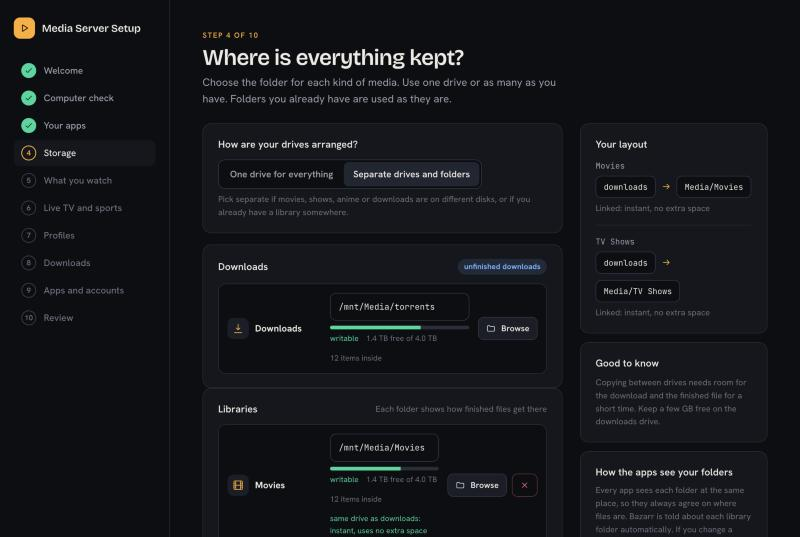
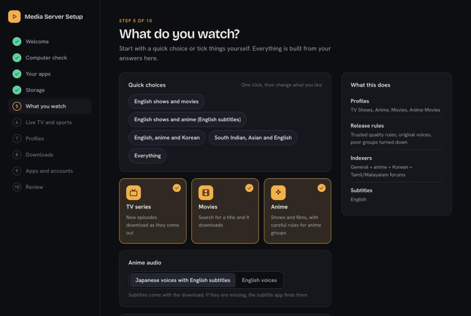
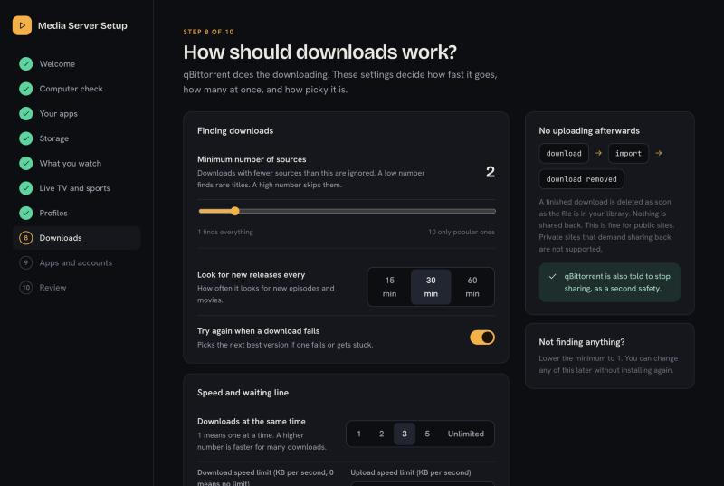
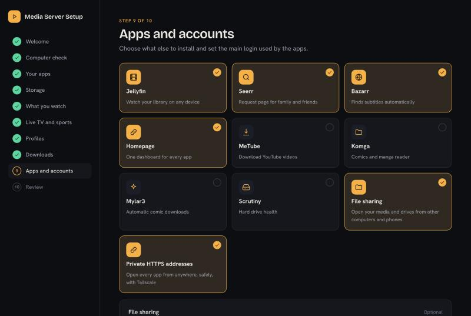
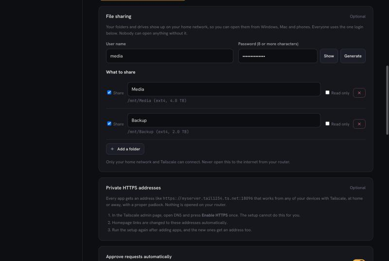
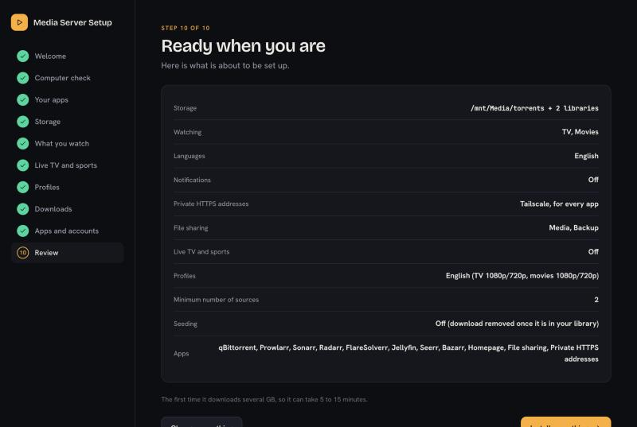

# Getting started

This page walks through the setup, one screen at a time. The same pages are in the guide on the website: open the setup and press **Open the guide** at the bottom of the left side.

## Before you start

1. A computer that can run Docker. Windows and Mac need Docker Desktop. Linux needs Docker Engine.
2. About 8 GB of memory and 20 GB of free space for the apps. Your media needs its own space.
3. An internet connection. The first install downloads several GB.

## Start it

Open the start file for your computer. Your browser opens at `http://localhost:7979`.

| Computer | File |
|---|---|
| Windows | Start on Windows.bat |
| Mac | Start on Mac.command (the first time, right click it and choose Open) |
| Linux | Run `bash "Start on Linux.sh"` in this folder |

Press **Start setup**. Nothing is installed until the very last screen.

## Step 2: Computer check

The setup checks Docker, your system, the network ports it needs, and whether you already run some of the apps.

If a port is busy, the setup picks a free one for you. If you already run some of the apps, the next step lets you keep them, see [What it sets up](What%20it%20sets%20up.md).

## Step 4: Where is everything kept?

Choose one folder for downloads and a folder for each kind of media. You can use one drive or many. Folders you already have are used as they are, and nothing is moved, renamed or deleted.

The panel on the right shows how a finished download reaches your library. **Same drive as downloads** means it is linked, which is instant and uses no extra space. **Different drive** means it is copied across and the download is removed.

Not sure how to prepare a drive? See the drive section in [File sharing](File%20sharing.md).

## Step 5: What do you watch?

Press a quick choice, or tick things yourself. Each choice changes the quality rules, the search sites and the subtitle languages.

## Steps 6 and 7: Live TV and profiles

Live TV and sports is optional, see [Live TV and VPN](Live%20TV%20and%20VPN.md). Profiles let you choose different quality for different people or kinds of media.

## Step 8: How should downloads work?

The defaults suit most people. The setup always removes a download once it is in your library, so nothing keeps uploading.

## Step 9: Apps and accounts

Choose what else to install. The first four are on by default. The other tiles are optional.

Two of the optional tiles have their own cards underneath:

1. **File sharing** shows your media and drives on your home network. Each folder or drive has a tick box and a read only option. See [File sharing](File%20sharing.md).
2. **Private HTTPS addresses** gives every app a safe address that works from anywhere with Tailscale. See [Private HTTPS](Private%20HTTPS.md).

You also choose the main login here. It is used by Jellyfin, Seerr, Sonarr, Radarr and Prowlarr.

## Step 10: Review and install

Press **Install everything**. The first time takes 5 to 15 minutes. You can stop at any time, and stopping never touches your media.

## When it finishes

The final page lists a link and a login for every app, and a test of each connection between them. It also tests a real search, so you know it works before you close the page.

1. Open Homepage. It has a button for every app.
2. Open Jellyfin and add the Jellyfin app on your phone or TV. Sign in with your main login.
3. Open Seerr and ask for something. Watch it arrive in Jellyfin.

To see how the pieces fit together, read [How everything fits](How%20everything%20fits.md).
