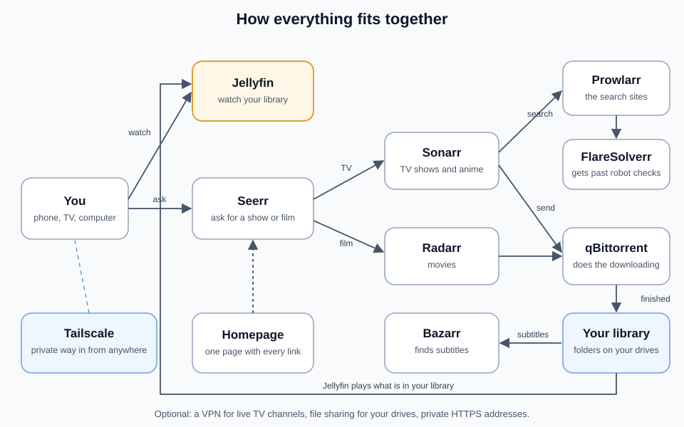

# How everything fits together

Each app does one small job. The setup connects them, so you only ever ask for something once and the rest happens by itself.

The small numbers on the arrows are the standard ports of each app. If one of them is busy on your computer, the setup picks a free one and shows it at the end.

## The story of one request

1. You open **Seerr** on your phone and ask for a film.
2. Seerr passes the request to **Radarr** (for films) or **Sonarr** (for shows and anime).
3. They ask **Prowlarr**, which keeps the list of search sites, to look for it. Some sites make visitors prove they are not a robot. **FlareSolverr** opens those sites in a hidden browser so the search still works.
4. The best match is sent to **qBittorrent**, which does the downloading. It stops uploading when it is done, so nothing keeps running in the background.
5. When it finishes, Radarr or Sonarr move it into your library folder and give it a clean name. On the same drive this is instant and uses no extra space.
6. **Bazarr** notices the new file and finds subtitles for it.
7. **Jellyfin** sees the new file in your library and it appears on every device.
8. You get a message in your chat app, if you set that up.

## What each app is for

| App | What it does for you | Where you open it |
|---|---|---|
| Jellyfin | Plays your films, shows, anime and live TV on phones, TVs and computers | The Jellyfin app on any device, or the web page |
| Seerr | The request page for you, your family and your friends | The Seerr web page |
| Sonarr | Finds and downloads TV shows and anime, and keeps them tidy | Rarely, it works by itself |
| Radarr | Finds and downloads films, and keeps them tidy | Rarely |
| Prowlarr | Keeps the list of search sites that Sonarr and Radarr use | When a search site stops working |
| qBittorrent | Does the downloading | Rarely |
| Bazarr | Finds subtitles in your languages | Rarely |
| FlareSolverr | Helps the searches get past robot checks | Never, it works quietly |
| Homepage | One page with a button for every app | Your home page in the browser |
| Kapowarr (optional) | Finds and downloads comics, and uses FlareSolverr for protected sites | Port 5656 |
| Kaizoku (optional) | Follows manga and downloads new chapters | Port 3001 |
| Komga (optional) | Reads comics and manga | Port 25600 |

The setup page shows a link to each of them when it finishes. Most days you only open Jellyfin and Seerr.

## The optional extras

| Extra | What it adds | Guide |
|---|---|---|
| Comics and manga | Kapowarr downloads comics, Kaizoku downloads manga, Komga reads both | Comics and manga |
| Live TV and sports | Free live channels with a TV guide inside Jellyfin | Live TV and VPN |
| File sharing | Your media folder and your drives shown on your home network | File sharing |
| Private HTTPS addresses | Every app gets a safe address that works from anywhere with Tailscale | Private HTTPS |
| Notifications | A message in your chat app when something downloads | Getting started |

## Where your files live

Downloads and your library should be on the same drive. Then a finished download is linked into the library instead of copied, which is instant and uses no extra space. The Storage step shows this for every folder you choose: "same drive as downloads" is what you want to see.

You never have to move or rename anything yourself. Sonarr and Radarr keep one tidy folder per film or show, and Jellyfin finds them by itself.
