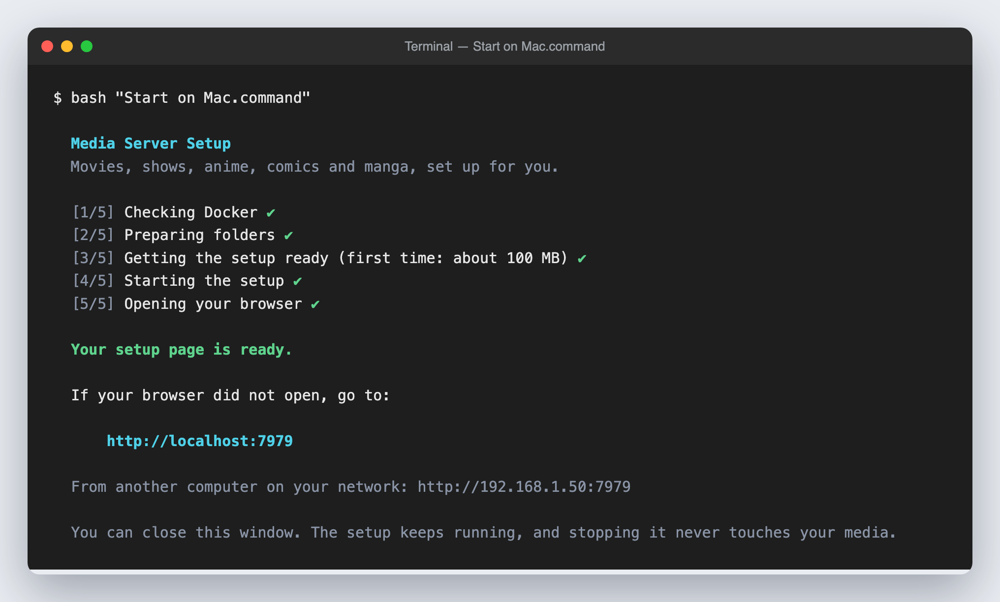
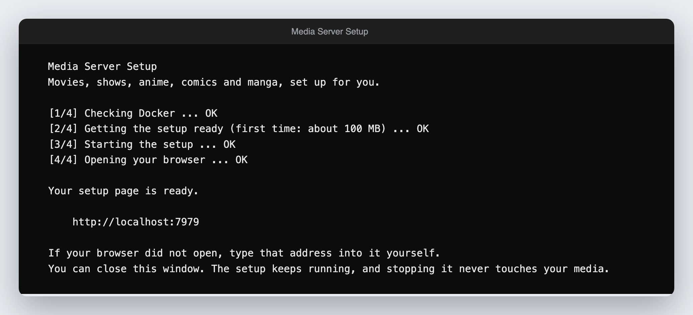
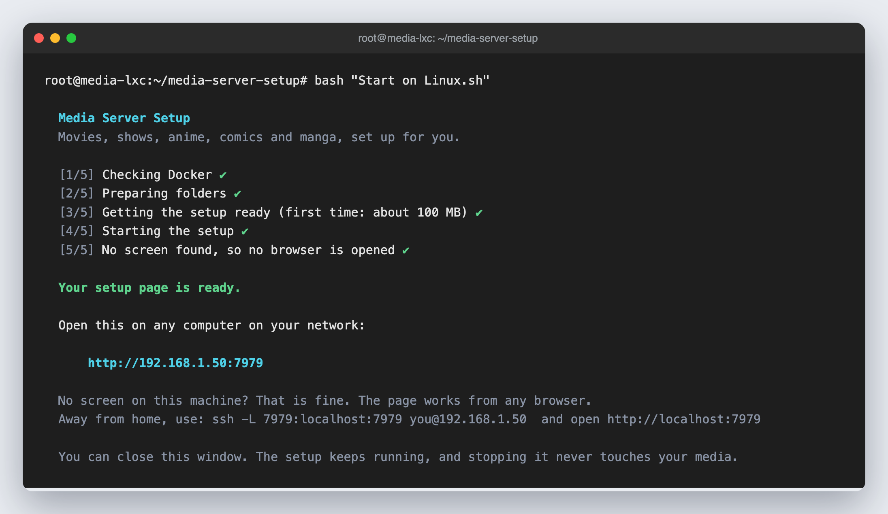

# Installing

Pick the one that matches your computer. Each one does the same thing: it checks Docker, gets the setup ready, starts it, and shows you a web address. Everything after that happens in your browser.

| Your computer | Easiest way |
|---|---|
| Windows | Double click `Start on Windows.bat` |
| Mac | Double click `Start on Mac.command` |
| Linux with a screen | Run `bash "Start on Linux.sh"` in the folder |
| A server, a Proxmox LXC or a VPS with no screen | Run the one-line installer below |

You need Docker first. Windows and Mac need Docker Desktop. Linux needs Docker Engine. If it is missing, the installer says so and opens the download page.

## The one-line installer

For Linux, Mac, a Proxmox LXC or any server. Copy this into a terminal and press Enter:

```bash
curl -fsSL https://raw.githubusercontent.com/Hikki-dev/media-server-setup/main/install.sh | bash
```

It downloads this project into `~/media-server-setup`, then runs the same start script as the files above.


It only touches that folder. Your media is never touched. Run it again any time to update.

## What you see while it starts

On Mac and Linux the window shows five steps. A spinner turns while a step is working, and a tick appears when it is done.



On Windows the same steps appear in the black window, as four lines that end in OK:



When it says **Your setup page is ready**, your browser opens by itself. If it does not, type the address shown into any browser. Then follow [Getting started](Getting%20started.md).

## On a server with no screen (an LXC)

On a machine with no screen the start script notices and does not try to open a browser. It prints an address instead. Open that address on any other computer on your network.



You can force this on any Linux computer by adding `--headless`:

```bash
bash "Start on Linux.sh" --headless
```

Notes for a Proxmox LXC:

1. Docker needs the container option **Nesting** switched on (Options, Features).
2. Use a Debian or Ubuntu container with at least 8 GB of memory and 20 GB of disk for the apps.
3. If you reach the server from outside your home, use Tailscale or an SSH tunnel: `ssh -L 7979:localhost:7979 you@server`, then open `http://localhost:7979`. Do not open port 7979 on your router. The setup page can install apps on the computer, so keep it on your home network.

## If it stops with a red cross

The window says what went wrong in plain words and shows the last lines the computer said.

| It says | What to do |
|---|---|
| Docker is not installed | Install Docker, then run it again |
| Docker is installed but not running | Start Docker Desktop (or `sudo systemctl start docker`) and run it again |
| Could not get the setup ready | Check your internet connection |
| Could not start the setup | Another program uses port 7979. Close it and run it again |

## Choosing other folders

By default the setup keeps its files in `~/ArrStack` and suggests `~/ArrMedia` for media. To use other places, set them first:

```bash
ARR_STACK_DIR=/srv/arr ARR_MEDIA_DIR=/mnt/media bash "Start on Linux.sh"
```
