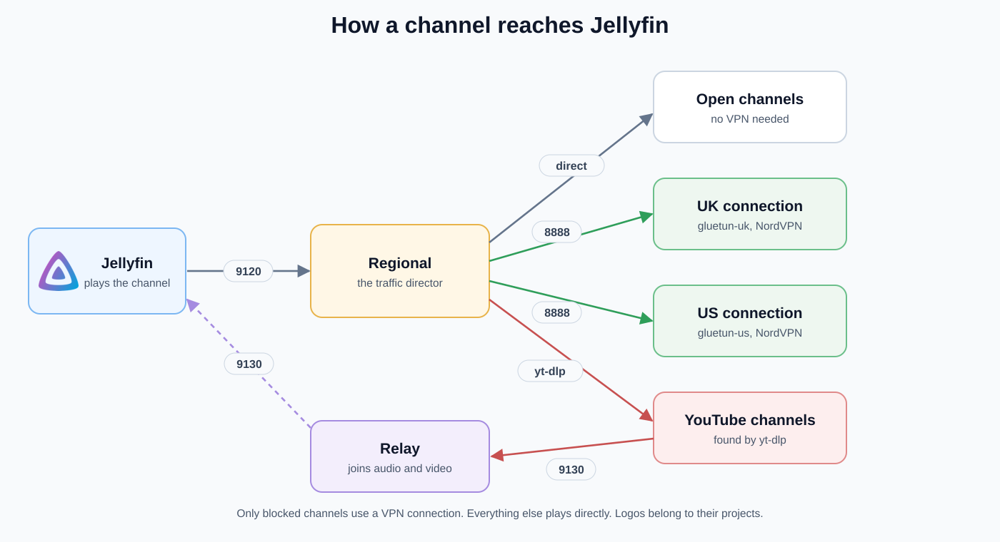
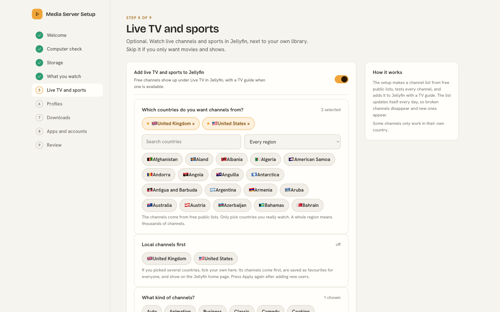

# Live TV and VPN

This page explains the VPN part of Live TV: why it is there, how a channel finds its way to Jellyfin, and what to do when one stops working. For how the channel list itself is built and updated every night, read [How Live TV works](How%20Live%20TV%20works.md).

## Why a VPN

Some free channels only play in their own country. A UK children's channel will not start for a viewer in another country, and many US channels do the same. A VPN makes the request look like it comes from the right country, so the channel agrees to play.

The setup uses NordVPN for this. It starts two small connections, one in the United Kingdom and one in the United States. These two are called gluetun-uk and gluetun-us, after the free program Gluetun that runs them.

Only blocked channels use a VPN connection. Everything else plays directly, so most channels start as fast as they always did.

## How a channel reaches Jellyfin

Jellyfin never talks to the VPN. It talks to one helper called Regional, on port 9120. Regional decides the route for each channel and passes the picture back.

The routes are these:

1. **Open channels** are fetched directly from their own address.
2. **Blocked channels** are fetched through the UK or the US connection. Each connection offers a small web proxy on port 8888 that only Regional can reach.
3. **YouTube channels** are looked up on demand, because YouTube changes its addresses all the time. The result goes through the relay on port 9130, which joins the separate picture and sound into one stream Jellyfin can play.

A blocked channel keeps its normal name and number in Jellyfin. Only its hidden address changes, so nothing looks different to you.

## What you need

You need a NordVPN **service login**. This is not your normal NordVPN email and password. You find it in your NordVPN account page, under the manual setup section. The login is saved in a private file on your own computer, and it is never written into any other file.

## Turn it on

In the setup, open the Live TV step, turn on NordVPN and paste the service username and password.

If you already have a server running, open the folder called NordVPN inside Extras. Run the file Start NordVPN there once and type your service login when asked. It starts the two connections for you and waits until Regional reports both of them as ready.

## Which channels use the VPN

Each night the setup tests every channel. When a channel is refused with a "not allowed" answer, it is tried again through the UK connection and then the US connection. If one of them works, the channel is kept and routed that way. If neither works, the channel is dropped from the list. The next night it is tried again, so a channel that comes back is picked up by itself.

## If a channel stops working

1. Check that both connections show as healthy in your Docker app or in Portainer.
2. If one is unhealthy, restart it. It will pick another NordVPN server.
3. Some channels only work for part of the day, or only while a match is on.
4. A VPN channel takes a few seconds longer to start than a direct one. That is normal.

More help is on the [Fixing problems](Fixing%20problems.md) page.
